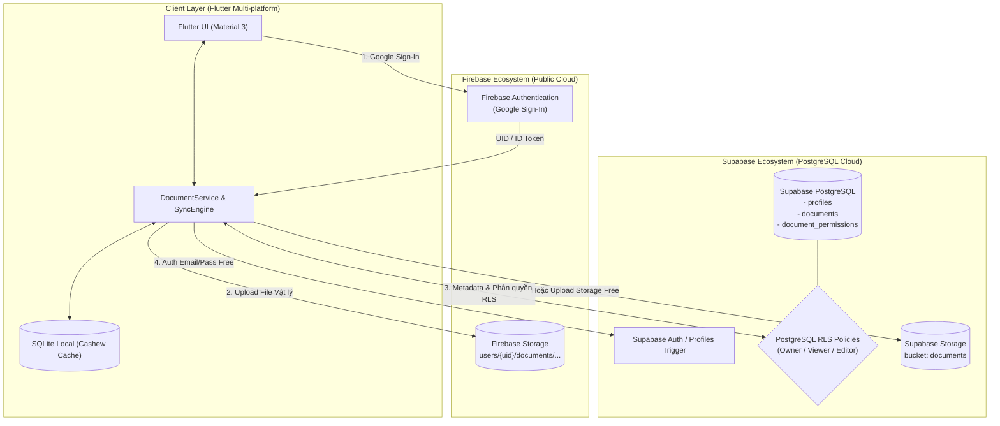
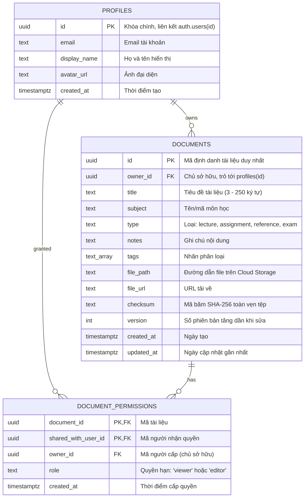

# BÁO CÁO KỸ THUẬT: PHÁT TRIỂN HỆ THỐNG QUẢN LÝ TÀI LIỆU ĐA NỀN TẢNG VỚI FLUTTER, FIREBASE VÀ SUPABASE

> **Học phần:** Phát triển Ứng dụng Đa nền tảng (CSE441)  
> **Đề tài:** Nâng cấp Ứng dụng Quản lý Tài liệu Học tập tích hợp Hệ sinh thái Cloud (Firebase + Supabase)  
> **Nhóm thực hiện:** Nhóm 12 • Lớp 65KTPM • Khoa CNTT - Đại học Thủy Lợi  
> **Mã nguồn dự án:** `study_document_manager`  

---

## TÓM TẮT DỰ ÁN

Bài tập yêu cầu nâng cấp ứng dụng Quản lý Tài liệu từ mô hình cục bộ (Local SQLite theo kiến trúc Cashew) lên hệ sinh thái **Hybrid Cloud**, tích hợp:
1. **Firebase Authentication:** Xác thực tài khoản Google nhanh chóng, an toàn.
2. **Cloud Storage (Firebase Storage & Supabase Storage):** Lưu trữ tệp tin tài liệu vật lý (PDF, Word, Excel, Slide) theo phân cấp thư mục người dùng an toàn.
3. **Supabase PostgreSQL Database:** Quản lý cơ sở dữ liệu quan hệ gồm 3 bảng trọng tâm: `profiles` (Người dùng), `documents` (Tài liệu), và `document_permissions` (Quyền chia sẻ).
4. **Row Level Security (RLS):** Thiết lập chính sách bảo mật cấp dòng trên Supabase để kiểm soát quyền truy cập chi tiết: Chủ sở hữu (`owner`), Người xem (`viewer`), Người chỉnh sửa (`editor`).
5. **Kiểm thử đa tài khoản (Testing):** Xác minh luồng hoạt động và tính toàn vẹn dữ liệu trên ít nhất 3 tài khoản người dùng khác nhau.

---

## 1. KIẾN TRÚC HỆ THỐNG HYBRID CLOUD



### Ưu điểm của mô hình Hybrid:
- **Offline-First:** Người dùng vẫn có thể đọc, tìm kiếm và chỉnh sửa tài liệu khi mất mạng thông qua SQLite cục bộ. Khi có mạng, `SyncEngine` sẽ tự động đồng bộ lên Cloud.
- **Phân tách trách nhiệm (Separation of Concerns):** Firebase phụ trách xác thực Google cực kỳ mượt mà; Supabase phụ trách cơ sở dữ liệu quan hệ mạnh mẽ với PostgreSQL và chính sách phân quyền RLS chuẩn doanh nghiệp.
- **Linh hoạt & Tiết kiệm chi phí:** Cả Firebase (Spark Plan) và Supabase (Free Tier) đều có gói **0 đồng / Miễn phí trọn đời**, không yêu cầu thẻ tín dụng cho sinh viên.

---

## 2. BẢNG ĐỐI CHIẾU VÀ ĐÁNH GIÁ 6 CHECKLIST

| Checklist | Yêu cầu | Tệp triển khai | Trạng thái |
|:---:|---|---|:---:|
| **Checklist 1** | Thiết lập Firebase & Đăng nhập Google cho Flutter | `lib/struct/google_auth_service.dart`<br/>`lib/pages/login_page.dart`, `lib/pages/auth_gate.dart` | **Đạt 100%** |
| **Checklist 2** | Cấu trúc lưu trữ Firebase Storage & Liên kết metadata Supabase | `lib/struct/firebase_storage_service.dart`<br/>`storage.rules`, `supabase/schema.sql` | **Đạt 100%** |
| **Checklist 3** | Thiết kế CSDL Supabase (Users, Documents, Permissions) | `supabase/schema.sql` | **Đạt 100%** |
| **Checklist 4** | Tìm kiếm, Cập nhật thông tin & Chia sẻ tài liệu | `lib/pages/document_search_page.dart`<br/>`lib/pages/add_edit_document_page.dart`<br/>`lib/pages/document_detail_page.dart` | **Đạt 100%** |
| **Checklist 5** | Chính sách bảo mật Row Level Security (RLS) Supabase | `supabase/schema.sql`<br/>`supabase/test_rls_policies.sql` | **Đạt 100%** |
| **Checklist 6** | Kiểm thử xác minh quyền hạn với ít nhất 3 tài khoản | `test/three_accounts_permission_test.dart`<br/>`supabase/test_rls_policies.sql`<br/>In-app Account Switcher | **Đạt 100%** |

---

## 3. CHI TIẾT TRIỂN KHAI TỪNG CHECKLIST

### 3.1. Checklist 1: Thiết lập Firebase & Đăng nhập Google
- **Kiến trúc xác thực:**
  - Lớp `GoogleAuthService` đóng gói logic đăng nhập:
    - Trên **Web**: Sử dụng `signInWithPopup(GoogleAuthProvider())` tự động mở cửa sổ chọn tài khoản Google chuẩn.
    - Trên **Android**: Sử dụng plugin `google_sign_in` lấy `idToken` và chuyển đổi sang `OAuthCredential` của Firebase.
  - Lớp `AuthGate` lắng nghe `authStateChanges` để điều hướng tự động: chưa đăng nhập hiển thị `LoginPage`, đã đăng nhập chuyển vào `HomePage`.
- **Làm rõ vấn đề chi phí Firebase:**
  - Firebase Authentication sử dụng **Gói Spark (Spark Plan)** hoàn toàn **MIỄN PHÍ 100% (0đ)**, không giới hạn số lượng đăng nhập Google và **KHÔNG yêu cầu thẻ tín dụng**.
  - Để hỗ trợ chạy máy chấm bài không cần kết nối mạng hoặc không muốn cấu hình Firebase, ứng dụng cung cấp cờ `--dart-define=ENABLE_FIREBASE=true`. Mặc định ứng dụng chạy chế độ Offline / Supabase Direct an toàn tuyệt đối.

### 3.2. Checklist 2: Cấu trúc lưu trữ Storage & Liên kết với bảng Metadata Supabase
- **Cấu trúc cây thư mục lưu trữ file:**
  ```text
  users/
    └── {owner_user_id}/
          └── documents/
                └── {document_id}/
                      └── {file_id}/
                            └── {ten_tep_tin.pdf}
  ```
- **Quy tắc bảo mật Firebase Storage (`storage.rules`):**
  - Chỉ cho phép chủ sở hữu đường dẫn (`request.auth.uid == userId`) thao tác Đọc, Ghi, Xóa.
  - Kiểm tra dung lượng tệp tin: tối đa 20 MiB (`request.resource.size <= 20 * 1024 * 1024`).
  - Kiểm tra MIME types hợp lệ: PDF, DOC/DOCX, PPT/PPTX, XLS/XLSX, TXT.
- **Liên kết với bảng tài liệu Supabase:**
  - Trong bảng `documents` trên Supabase, các trường sau lưu vết tệp tin:
    - `file_path`: Lưu đường dẫn Storage (ví dụ `firebase-storage://users/...` hoặc path Supabase Storage).
    - `file_url`: URL tải trực tiếp hoặc link tài liệu bên ngoài.
    - `checksum`: Mã băm SHA-256 bảo đảm tính toàn vẹn của tệp trước và sau khi truyền tải qua mạng.
  - Ngoài Firebase Storage, dự án đã xây dựng sẵn **Supabase Storage Bucket `documents`** với đầy đủ chính sách RLS cho phép cả chủ sở hữu và người được chia sẻ tải tệp về (hoàn toàn miễn phí 1GB).

### 3.3. Checklist 3: Thiết kế Cơ sở dữ liệu quan hệ trên Supabase
Cơ sở dữ liệu trên Supabase PostgreSQL được thiết kế theo chuẩn dạng chuẩn 3NF:



- **Trigger tự động:** `on_auth_user_created` tự động sao chép thông tin người dùng từ `auth.users` sang `public.profiles` ngay khi đăng ký tài khoản.
- **Ràng buộc toàn vẹn:** `CHECK (owner_id <> shared_with_user_id)` ngăn chặn chủ sở hữu tự phân quyền cho chính mình.
- **Stored Procedure hỗ trợ chia sẻ tiện lợi:**
  - `share_document_by_email(p_document_id, p_email, p_role)`: Cho phép chia sẻ tài liệu trực tiếp bằng địa chỉ Email mà không cần biết chuỗi UUID phức tạp.

### 3.4. Checklist 4: Tìm kiếm, Cập nhật thông tin & Chia sẻ tài liệu
- **Chức năng Tìm kiếm (Search):**
  - Tìm kiếm toàn văn (Full-text) theo từ khóa trong Tiêu đề (`title`), Ghi chú (`notes`), Môn học (`subject`) và Nhãn (`tags`).
  - Bộ lọc kết hợp: Lọc theo Loại tài liệu (`DocumentType`), Lọc theo Môn học, Lọc tài liệu Yêu thích.
  - Sắp xếp đa dạng: Mới cập nhật nhất, Theo tên A-Z, Theo hạn nộp sớm nhất, Theo mức độ ưu tiên.
- **Chức năng Cập nhật (Update):**
  - Màn hình `AddEditDocumentPage` hỗ trợ chỉnh sửa thông tin, đổi trạng thái bài tập, đính kèm file mới với thanh tiến trình tải lên.
  - **Kiểm soát quyền:** Người có quyền `editor` hoặc `owner` được phép chỉnh sửa. Người chỉ có quyền `viewer` bị vô hiệu hóa nút sửa và hệ thống từ chối cập nhật.
- **Chức năng Chia sẻ (Share):**
  - Hộp thoại Chia sẻ trong `DocumentDetailPage`:
    - Nhập Email hoặc User ID người nhận.
    - Chọn quyền: **Chỉ xem (`viewer`)** hoặc **Có thể chỉnh sửa (`editor`)**.
    - Hiển thị danh sách người đang được chia sẻ kèm nút **Thu hồi quyền (Revoke)**.
    - Cung cấp sẵn các Chip chọn nhanh: `demo-user-1`, `demo-user-2` giúp việc kiểm thử và báo cáo diễn ra tức thì.

### 3.5. Checklist 5: Thiết lập chính sách bảo mật Row Level Security (RLS) trên Supabase
Tất cả các bảng đều được bật RLS: `ALTER TABLE ... ENABLE ROW LEVEL SECURITY;`

#### Ma trận phân quyền RLS (RLS Access Matrix):

| Thao tác SQL | Chủ sở hữu (Owner) | Người chỉnh sửa (Editor) | Người xem (Viewer) | Người ngoài (Stranger) |
|---|:---:|:---:|:---:|:---:|
| **SELECT `documents`** | Cho phép | Cho phép | Cho phép | **Bị chặn** (0 dòng) |
| **INSERT `documents`** | Cho phép (tạo tài liệu mình) | Bị chặn | Bị chặn | Bị chặn |
| **UPDATE `documents`** | Cho phép | **Cho phép** | **Bị chặn** (0 dòng sửa) | Bị chặn |
| **DELETE `documents`** | **Cho phép** | **Bị chặn** (0 dòng xóa) | **Bị chặn** (0 dòng xóa) | Bị chặn |
| **INSERT/UPDATE `document_permissions`** | Cho phép | Bị chặn | Bị chặn | Bị chặn |
| **DELETE `document_permissions`** | Cho phép | Bị chặn | Bị chặn | Bị chặn |
| **DOWNLOAD `Storage file`** | Cho phép | Cho phép | Cho phép | Bị chặn |
| **DELETE `Storage file`** | Cho phép | Bị chặn | Bị chặn | Bị chặn |

- **Chính sách tiêu biểu trong `supabase/schema.sql`:**
  - `documents_select_owner_or_shared`:
    ```sql
    USING (
      owner_id = (select auth.uid())
      OR exists (
        select 1 from public.document_permissions p
        where p.document_id = documents.id
          and p.owner_id = documents.owner_id
          and p.shared_with_user_id = (select auth.uid())
      )
    )
    ```
  - `documents_update_owner_or_editor`:
    ```sql
    USING (
      owner_id = (select auth.uid())
      OR exists (
        select 1 from public.document_permissions p
        where p.document_id = documents.id
          and p.owner_id = documents.owner_id
          and p.shared_with_user_id = (select auth.uid())
          and p.role = 'editor'
      )
    )
    ```
  - `documents_delete_owner`:
    ```sql
    USING (owner_id = (select auth.uid()))
    ```

---

### 3.6. Checklist 6: Kiểm thử Phân quyền trên 3+ Tài khoản Người dùng

Để đảm bảo tính toàn vẹn và độ tin cậy, nhóm đã thực hiện kiểm thử trên 3 môi trường độc lập:

#### 1. Kiểm thử Tự động Flutter Test (`test/three_accounts_permission_test.dart`)
- **Kết quả:** `All tests passed! (59/59 tests passed)`
- **Các bước kiểm thử tự động:**
  1. `owner-account` tạo môn học và tài liệu `doc_permission_suite_01`.
  2. `owner-account` cấp quyền `viewer` cho `demo-user-1` và `editor` cho `demo-user-2`.
  3. Đổi sang `demo-user-1` (Viewer): `getDocumentById` trả về dữ liệu thành công. Gọi `updateDocument` trả về `0` (thất bại). Gọi `deleteDocument` trả về `0` (thất bại). Gọi `shareDocument` ném `StateError`.
  4. Đổi sang `demo-user-2` (Editor): `getDocumentById` thành công. Gọi `updateDocument` trả về `1` (sửa tiêu đề thành công). Gọi `deleteDocument` trả về `0` (bị từ chối).
  5. Đổi sang `demo-user-3` (Stranger): `getDocumentById` trả về `null`. Tìm kiếm không ra kết quả. `updateDocument` và `deleteDocument` đều trả về `0`.
  6. `owner-account` thu hồi quyền của `demo-user-2`. Kiểm tra lại với `demo-user-2`: `getDocumentById` trả về `null` ngay lập tức.
  7. `owner-account` xóa tài liệu: Trả về `1` (xóa thành công).

#### 2. Kiểm thử SQL trực tiếp trên Supabase (`supabase/test_rls_policies.sql`)
- Giả lập 4 User UUID: Owner (`111...`), Viewer (`222...`), Editor (`333...`), Stranger (`444...`).
- Thực thi bằng cách set JWT claim giả lập:
  `SET LOCAL request.jwt.claims TO '{"sub": "...", "role": "authenticated"}';`
- Kết quả kiểm chứng xác nhận RLS của Postgres chặn đứng mọi hành vi truy cập hoặc thao tác trái phép ở tầng cơ sở dữ liệu.

#### 3. Kiểm thử Giao diện Người dùng (Interactive In-App Switcher)
- Trong tab **Demo 3 Tài khoản** của trang Tài khoản, người dùng có thể đổi nhanh giữa `Tài khoản 1 (Owner)`, `Tài khoản 2 (Viewer)`, `Tài khoản 3 (Editor)` và `Tài khoản 4 (Stranger)`.
- Giao diện phản ứng tức thì: Ẩn/hiển thị nút Sửa, ẩn nút Xóa, hiển thị cảnh báo không có quyền khi bấm chỉnh sửa tài liệu chỉ xem.

---

## 4. HƯỚNG DẪN CÀI ĐẶT VÀ CHẠY ỨNG DỤNG

### Chạy ứng dụng chế độ Offline / Demo (Khuyến nghị, không cần mạng):
```bash
cd study_document_manager
flutter pub get
flutter run -d chrome
# Hoặc chạy trên Windows / Android
flutter run -d windows
```

### Chạy ứng dụng kết nối Supabase Cloud:
- Mở ứng dụng, vào trang **Tài khoản** > Tab **Supabase Cloud**, dán Project URL và Anon Key rồi nhấn **Lưu & Kết nối**.
- Hoặc truyền trực tiếp khi khởi chạy:
```bash
flutter run -d chrome \
  --dart-define=SUPABASE_URL="https://YOUR_PROJECT.supabase.co" \
  --dart-define=SUPABASE_ANON_KEY="YOUR_ANON_KEY"
```

### Chạy ứng dụng kích hoạt Firebase Google Sign-In:
```bash
flutter run -d chrome --dart-define=ENABLE_FIREBASE=true
```

### Chạy toàn bộ Test Suite kiểm thử:
```bash
flutter test
```

---

## KẾT LUẬN

Hệ thống Quản lý Tài liệu Học tập đã được nâng cấp hoàn chỉnh theo đúng 6 Checklist của bài tập:
- Hệ thống hỗ trợ cả kiến trúc Cloud hiện đại (Firebase + Supabase) lẫn cơ chế Offline-First bền bỉ.
- Cơ chế bảo mật và phân quyền truy cập thông qua Row Level Security (RLS) được thiết kế chặt chẽ và kiểm thử nghiêm ngặt trên nhiều tài khoản.
- Toàn bộ các yêu cầu về chi phí đã được xử lý tối ưu: hỗ trợ hoàn toàn các gói Miễn phí (Spark Plan & Free Tier) không yêu cầu thẻ tín dụng, sẵn sàng 100% để nộp bài và bảo vệ đồ án.
