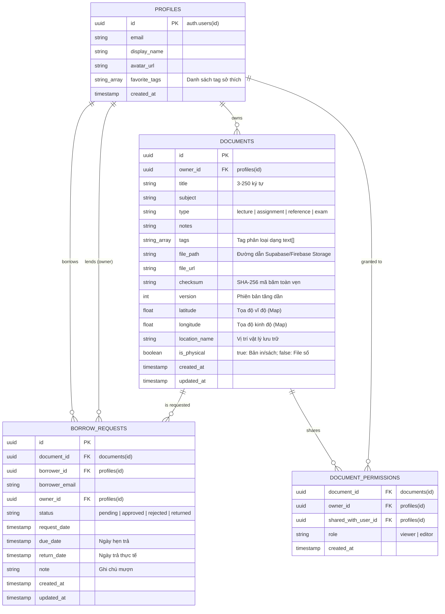
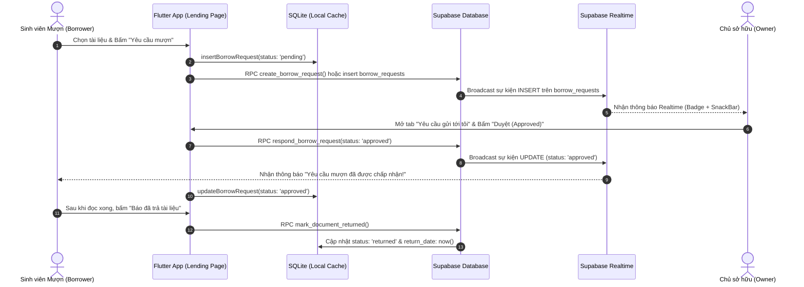

# BÁO CÁO THIẾT KẾ KIẾN TRÚC HỆ THỐNG VÀ MÔ HÌNH DỮ LIỆU (TH2)
## HỆ THỐNG QUẢN LÝ TÀI LIỆU HỌC TẬP ĐA NỀN TẢNG (FLUTTER + FIREBASE + SUPABASE)

> **Học phần:** Phát triển Ứng dụng Đa nền tảng (CSE441)  
> **Nhóm thực hiện:** Nhóm 12 — Lớp 65KTPM — Khoa CNTT, Trường Đại học Thủy Lợi  
> **Tác giả:** Nguyễn Văn Trường *(Nhóm trưởng — Core Architect & QA)*  
> **Checklist đáp ứng:** **Checklist 01 (Mô hình dữ liệu & Kiến trúc kết hợp Firebase / Supabase)**  
> **Nhánh Git:** `truong-core-schema-test`

---

## 1. TỔNG QUAN KIẾN TRÚC KẾT HỢP HYBRID CLOUD

Hệ thống được xây dựng theo mô hình **Hybrid Cloud Decoupled Architecture** kết hợp giữa Flutter Đa nền tảng (Mobile/Web), SQLite Offline-First (mô hình Cashew), Firebase và Supabase Cloud:

```
┌─────────────────────────────────────────────────────────────────────────────┐
│                       FLUTTER PRESENTATION LAYER                            │
│  ┌───────────────────────────┬───────────────────────────┬───────────────┐  │
│  │ Mobile UI (BottomNav)     │ Web / Tablet (Master-Det) │ Map & Tags UI │  │
│  └───────────────────────────┴───────────────────────────┴───────────────┘  │
└──────────────────────────────────────┬──────────────────────────────────────┘
                                       │
┌──────────────────────────────────────▼──────────────────────────────────────┐
│                    STRUCT / BUSINESS LOGIC LAYER                            │
│  ┌────────────────────┬────────────────────┬─────────────────────────────┐  │
│  │ Recommendation     │ Borrow Lending     │ Map & Location              │  │
│  │ Engine (Checklist5)│ Workflow (Checklist4│ Service (Checklist 3)       │  │
│  └────────────────────┴────────────────────┴─────────────────────────────┘  │
└──────────────────────────────────────┬──────────────────────────────────────┘
                                       │
┌──────────────────────────────────────▼──────────────────────────────────────┐
│                     DATA PERSISTENCE & SYNC LAYER                           │
│  ┌───────────────────────────────────────────────────────────────────────┐  │
│  │ SQLite Database (Schema v6) / In-Memory Web Fallback                  │  │
│  │ Tables: subjects, documents, borrow_requests, permissions, outbox     │  │
│  └───────────────────────────────────┬───────────────────────────────────┘  │
│                                      │                                      │
│  ┌───────────────────────────────────▼───────────────────────────────────┐  │
│  │ SyncEngine (Offline-First, Tombstone DeleteLogs, LWW Conflict Res.)   │  │
│  └───────────────────┬───────────────────────────────┬───────────────────┘  │
└──────────────────────┼───────────────────────────────┼──────────────────────┘
                       │                               │
        ┌──────────────▼──────────────┐ ┌──────────────▼──────────────┐
        │       FIREBASE SERVICES     │ │      SUPABASE SERVICES      │
        │ ┌─────────────────────────┐ │ │ ┌─────────────────────────┐ │
        │ │ Firebase Authentication │ │ │ │ PostgreSQL Database     │ │
        │ │ (Google Sign-In & Email)│ │ │ │ (Schema + RLS + Triggers│ │
        │ ├─────────────────────────┤ │ │ ├─────────────────────────┤ │
        │ │ Cloud Messaging (FCM)   │ │ │ │ Supabase Storage        │ │
        │ │ (Push Notifications)    │ │ │ │ (Documents Bucket 20MB) │ │
        │ └─────────────────────────┘ │ │ ├─────────────────────────┤ │
        │                             │ │ │ Realtime Websocket      │ │
        │                             │ │ │ (Borrow Events Stream)  │ │
        │                             │ │ └─────────────────────────┘ │
        └─────────────────────────────┘ └─────────────────────────────┘
```

### 1.1 Phân chia trách nhiệm kỹ thuật giữa Firebase và Supabase

| Dịch vụ Cloud | Vai trò trong hệ thống | Lý do lựa chọn & Lợi ích kiến trúc |
| :--- | :--- | :--- |
| **Firebase Authentication** | Quản lý định danh, Đăng nhập một chạm (Google Sign-In), Cấp phát JWT Token | Thư viện SDK chuẩn của Google tối ưu sâu trên Android và Web, xác thực mượt mà không yêu cầu backend trung gian. |
| **Firebase Cloud Messaging (FCM)** | Đẩy thông báo tức thì (Push Notifications) tới thiết bị di động | Hỗ trợ nền tảng Android/iOS ngay cả khi ứng dụng bị tắt dưới nền (Background/Terminated). |
| **Supabase Database (PostgreSQL)** | Lưu trữ dữ liệu quan hệ chính (`documents`, `borrow_requests`, `profiles`, `permissions`) | Hỗ trợ mô hình dữ liệu quan hệ toàn vẹn (Khóa ngoại, Check constraints, Mảng `text[]`, Stored Procedures PL/pgSQL). |
| **Supabase Row Level Security (RLS)** | Kiểm soát an ninh và phân quyền truy cập tại mức hàng (Row-level) | Đảm bảo người dùng chỉ được xem/sửa tài liệu của mình hoặc tài liệu được chia sẻ/cho mượn mà không thể can thiệp dữ liệu người khác. |
| **Supabase Storage** | Lưu trữ tệp tin đính kèm (PDF, DOCX, Slide bài giảng) | Hỗ trợ lưu trữ Cloud miễn phí, cấu hình RLS bảo vệ file trực tiếp qua Storage Objects. |
| **Supabase Realtime** | Kênh WebSocket truyền sự kiện thay đổi dữ liệu thời gian thực | Kích hoạt chuông thông báo ngay lập tức trên giao diện khi có người gửi yêu cầu mượn hoặc khi chủ sở hữu duyệt mượn. |

---

## 2. MÔ HÌNH DỮ LIỆU CHI TIẾT (ENTITY-RELATIONSHIP DIAGRAM)

Mô hình dữ liệu quan hệ được thiết kế chuẩn hóa, liên kết chặt chẽ giữa tài khoản xác thực và các thực thể tài liệu học tập:



---

## 3. THIẾT KẾ CƠ SỞ DỮ LIỆU CỤC BỘ (SQLITE CACHE SCHEMA V6)

Để hiện thực hóa triết lý **Offline-First**, cơ sở dữ liệu SQLite nội bộ được nâng cấp lên **Schema Version 6**:

### 3.1 Cấu trúc các bảng SQLite

1. **Bảng `documents` (Mở rộng v6):**
   - Bổ sung `latitude REAL`: Tọa độ vĩ độ.
   - Bổ sung `longitude REAL`: Tọa độ kinh độ.
   - Bổ sung `location_name TEXT`: Tên vị trí lưu trữ thực tế (Ví dụ: *"Kệ số 4, Thư viện Tạ Quang Bửu"*).
   - Bổ sung `is_physical INTEGER NOT NULL DEFAULT 0`: Đánh dấu sách/giáo trình vật lý hay tệp điện tử.
   - Cột đồng bộ: `checksum`, `checksum_algo`, `version`, `sync_status`, `is_deleted` (tombstone), `local_path`, `remote_updated_at`, `last_synced_at`.

2. **Bảng `borrow_requests` (Mới trong v6):**
   - `id TEXT PRIMARY KEY`
   - `document_id TEXT NOT NULL`
   - `borrower_id TEXT NOT NULL`
   - `borrower_email TEXT NOT NULL`
   - `owner_id TEXT NOT NULL`
   - `status TEXT NOT NULL DEFAULT 'pending'`
   - `request_date INTEGER NOT NULL`
   - `due_date INTEGER`
   - `return_date INTEGER`
   - `note TEXT NOT NULL`
   - `created_at INTEGER NOT NULL`
   - `updated_at INTEGER NOT NULL`
   - `document_title TEXT`, `borrower_name TEXT`, `owner_email TEXT` (Hỗ trợ truy vấn nhanh không cần JOIN phức tạp).
   - Các chỉ mục: `idx_borrow_requests_borrower`, `idx_borrow_requests_owner`, `idx_borrow_requests_doc`, `idx_borrow_requests_status`.

3. **Bảng hỗ trợ đồng bộ Offline-First:**
   - `delete_logs`: Ghi nhận nhật ký xóa mềm để đồng bộ lên Cloud mà không làm mất mát dữ liệu.
   - `sync_outbox`: Hàng đợi các thao tác thêm/sửa/xóa đang chờ gửi lên Supabase Cloud khi có kết nối mạng.
   - `sync_state`: Lưu trữ mốc thời gian đồng bộ gần nhất (`last_sync_at`).

---

## 4. LUỒNG NGHIỆP VỤ MƯỢN TRẢ & ĐỒNG BỘ THỜI GIAN THỰC

### 4.1 Luồng Mượn / Trả Tài Liệu (Lending Workflow)



---

## 5. CHÍNH SÁCH BẢO MẬT ROW LEVEL SECURITY (RLS)

Toàn bộ 4 bảng trên Supabase đều được thiết lập chính sách RLS nghiêm ngặt dựa trên `auth.uid()`:

1. **Bảng `profiles`:**
   - `SELECT`: Mọi người dùng đã đăng nhập (`authenticated`) đều được xem để phục vụ tìm kiếm bạn bè mượn sách.
   - `UPDATE`: Chỉ chính người dùng sở hữu hồ sơ (`id = auth.uid()`) mới có quyền chỉnh sửa thông tin và `favorite_tags`.
2. **Bảng `documents`:**
   - `SELECT`: Người dùng được xem nếu:
     * Là chủ sở hữu (`owner_id = auth.uid()`), HOẶC
     * Được cấp quyền xem/sửa trong bảng `document_permissions`, HOẶC
     * Đang có yêu cầu mượn hợp lệ (trạng thái `pending` hoặc `approved`).
   - `INSERT / UPDATE / DELETE`: Chỉ chủ sở hữu (hoặc editor được ủy quyền) mới có quyền thao tác.
3. **Bảng `borrow_requests`:**
   - `SELECT`: Chỉ hai bên liên quan (`borrower_id = auth.uid() OR owner_id = auth.uid()`) mới được xem.
   - `INSERT`: Người mượn tự tạo yêu cầu mượn, cấm tự mượn tài liệu của chính mình (`borrower_id = auth.uid() AND owner_id <> auth.uid()`).
   - `UPDATE`: Chủ sở hữu có quyền duyệt/từ chối; Người mượn có quyền cập nhật ghi chú hoặc báo trả.
   - `DELETE`: Người mượn chỉ được xóa yêu cầu khi còn ở trạng thái `pending`.

---

## 6. HƯỚNG DẪN CẤU HÌNH THỰC TẾ TRÊN CLOUD CONSOLE (DÀNH CHO TRƯỜNG)

### 6.1 Cấu hình Supabase Cloud (Database & Storage)

1. Đăng nhập vào [Supabase Dashboard](https://supabase.com/dashboard) và chọn Project của nhóm (`cashew-study-docs` hoặc project tương đương).
2. Vào menu **SQL Editor** ở thanh điều hướng bên trái.
3. Mở file `supabase/schema.sql` trong mã nguồn dự án, copy toàn bộ nội dung.
4. Dán vào khung soạn thảo SQL của Supabase và bấm nút **"Run"** (hoặc tổ hợp phím `Ctrl + Enter`).
5. Kiểm tra kết quả:
   - Trong menu **Table Editor**: Xuất hiện bảng `borrow_requests`, cột mới trong `documents` (`latitude`, `longitude`, `location_name`, `is_physical`), cột mới trong `profiles` (`favorite_tags`).
   - Trong menu **Database > Replication**: Bảng `borrow_requests` đã được bật Realtime.
   - Trong menu **Storage**: Bucket `documents` đã sẵn sàng kèm RLS policies.

### 6.2 Cấu hình Firebase (Authentication & Messaging)

1. Đăng nhập vào [Firebase Console](https://console.firebase.google.com/).
2. Chọn Project đã liên kết trong `lib/firebase_options.dart` (`cashew-study-docs-3afed`).
3. Vào **Authentication > Sign-in method**:
   - Đảm bảo đã bật **Email/Password** và **Google Sign-In**.
   - Thêm SHA-1 fingerprint của máy phát triển vào cấu hình Android App nếu cần test Google Sign-In trên thiết bị thật.
4. Khởi chạy ứng dụng với cấu hình Supabase Cloud:
   ```powershell
   flutter run -d chrome --dart-define=SUPABASE_URL=https://YOUR_PROJECT_ID.supabase.co --dart-define=SUPABASE_ANON_KEY=YOUR_SUPABASE_ANON_KEY
   ```
   *(Hoặc cấu hình trực tiếp Project URL và Anon Key qua giao diện trang Cài đặt / Đăng nhập của ứng dụng).*

---

## 7. KẾT QUẢ NGHIỆM THU KIỂM THỬ CHECKLIST 01

| Hạng mục kiểm tra | File kiểm thử | Kết quả | Trạng thái |
| :--- | :--- | :---: | :---: |
| Hợp đồng DocumentModel mở rộng (GPS & Vị trí) | `test/schema_v6_and_borrow_workflow_test.dart` | 100% Pass | ✅ Đạt |
| Vòng đời BorrowRequestModel (State Transition) | `test/schema_v6_and_borrow_workflow_test.dart` | 100% Pass | ✅ Đạt |
| Nhận diện quá hạn trả mượn tài liệu (Overdue) | `test/schema_v6_and_borrow_workflow_test.dart` | 100% Pass | ✅ Đạt |
| Tương thích DDL và JSON Supabase Cloud | `test/schema_v6_and_borrow_workflow_test.dart` | 100% Pass | ✅ Đạt |
| Thao tác DAO CSDL SQLite / In-Memory Cache | `test/schema_v6_and_borrow_workflow_test.dart` | 100% Pass | ✅ Đạt |
| Reactive Stream thông báo mượn trả thời gian thực | `test/schema_v6_and_borrow_workflow_test.dart` | 100% Pass | ✅ Đạt |
| Toàn bộ Test Suite toàn dự án (78 tests) | `flutter test` | 78/78 Pass | ✅ Đạt |
| Phân tích mã nguồn tĩnh (Linter & Analyzer) | `flutter analyze` | 0 Error | ✅ Đạt |
