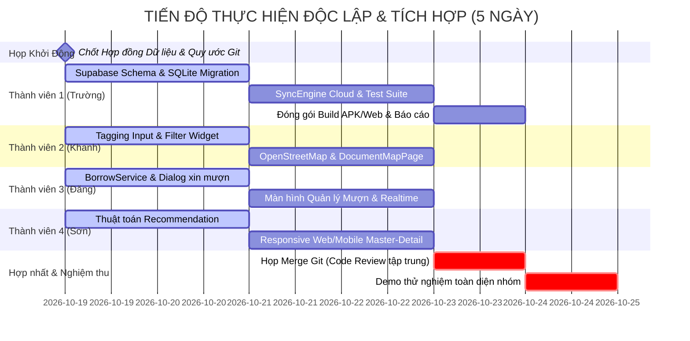

# KẾ HOẠCH PHÂN CÔNG NHIỆM VỤ — ĐỀ TÀI TH2
## HỆ THỐNG QUẢN LÝ TÀI LIỆU ĐA NỀN TẢNG (FLUTTER + FIREBASE + SUPABASE)

> **Học phần:** Phát triển Ứng dụng Đa nền tảng (CSE441)  
> **Nhóm thực hiện:** Nhóm 12 — Lớp 65KTPM — Khoa CNTT, Trường Đại học Thủy Lợi  
> **Dự án:** `study_document_manager`  
> **Phương pháp làm việc:** Độc lập cao (Decoupled & Contract-First), song song hóa luồng phát triển trên Git.

---

## 📌 NGUYÊN TẮC THIẾT KẾ ĐỘC LẬP (TRÁNH PHỤ THUỘC LẪN NHAU)

Để khắc phục triệt để tình trạng **"Người này phải chờ người kia làm xong mới bắt đầu được"**, nhóm áp dụng 3 quy tắc kỹ thuật sau:

1. **Quy ước Hợp đồng Dữ liệu (Contract-First):**
   - Toàn bộ thuộc tính mới của `DocumentModel`, `BorrowRequestModel`, `UserProfile` được chốt cố định ngay tại Mục 1 dưới đây.
   - Mỗi thành viên phát triển tính năng dựa trên Model này mà không cần chờ cơ sở dữ liệu hoàn thiện.
2. **Cơ chế Mock Dịch vụ Độc lập (Mock Services):**
   - Mỗi thành viên khi làm giao diện/nghiệp vụ sẽ tự tạo một `MockData` hoặc `MockService` cục bộ để chạy thử màn hình và logic của mình độc lập 100%.
   - Khi ghép nối (Integration), chỉ cần thay thế Mock Service bằng Service thật kết nối Supabase/Firebase.
3. **Phân nhánh Git độc lập (Feature Branching):**
   - Mỗi người làm việc trên nhánh riêng: `feature/map-tagging`, `feature/borrow-flow`, `feature/recommend-responsive`, `feature/core-schema-test`.

---

## 📐 HỢP ĐỒNG DỮ LIỆU CHUNG (DATA CONTRACT CHỐT NGÀY ĐẦU)

Mọi thành viên tuân thủ cấu trúc dữ liệu sau để không bị xung đột code:

```dart
// 1. Thuộc tính bổ sung cho DocumentModel
double? latitude;          // Tọa độ vĩ độ (vd: 21.0074)
double? longitude;         // Tọa độ kinh độ (vd: 105.8247)
String? locationName;      // Vị trí vật lý: "Tủ B3, Thư viện Tạ Quang Bửu"
bool isPhysical;           // true: Sách/giáo trình vật lý; false: File số
List<String> tags;         // Danh sách thẻ phân loại: ["#Flutter", "#Mobile"]

// 2. Mô hình Mượn/Trả tài liệu (BorrowRequestModel)
class BorrowRequestModel {
  final String id;
  final String documentId;
  final String borrowerId;
  final String borrowerEmail;
  final String ownerId;
  final String status;     // 'pending' | 'approved' | 'rejected' | 'returned'
  final DateTime requestDate;
  final DateTime? dueDate;
  final DateTime? returnDate;
  final String note;
}

// 3. Sở thích người dùng trong Profile (UserInterests)
List<String> favoriteTags; // Danh sách tag quan tâm: ["#AI", "#Flutter"]
```

---

## 👥 BẢNG PHÂN CÔNG TỔNG QUAN (4 THÀNH VIÊN)

| Thành viên | Vai trò | Phụ trách Checklist | Phạm vi công việc chính | Nhánh Git |
| :--- | :--- | :--- | :--- | :--- |
| **Thành viên 1**<br/>**Nguyễn Văn Trường** *(Nhóm trưởng)* | **Core Architect & QA** | **Checklist 01 & 06** | Kiến trúc dữ liệu Hybrid Cloud (Supabase Schema + SQLite Cache), Cơ chế đồng bộ SyncEngine, Bộ Test tự động & Đóng gói sản phẩm (Build APK/Web). | `truong-core-schema-test` |
| **Thành viên 2**<br/>**Vũ Tuấn Khanh** | **Map & Tagging Engineer** | **Checklist 03** | Hệ thống gắn thẻ Tag nâng cao (Input Chip, Tag Filter) và Quản lý vị trí vật lý trên bản đồ tương tác (OpenStreetMap / `flutter_map`). | `khanh-map-tagging` |
| **Thành viên 3**<br/>**Vũ Hải Đăng** | **Lending & Notification Engineer** | **Checklist 04 & 01 (Msg)** | Luồng nghiệp vụ Mượn/Trả tài liệu (State Machine), Giao diện duyệt yêu cầu, Lịch sử mượn & Cơ chế thông báo Realtime/Messaging. | `dang-borrow-flow` |
| **Thành viên 4**<br/>**Lý Đình Sơn** | **Algorithm & Responsive UI Engineer** | **Checklist 05 & 02** | Thuật toán Gợi ý tài liệu (Recommendation Engine), Bố cục giao diện đa nền tảng Responsive (Master-Detail, NavigationRail cho Web/Tablet). | `son-recommend-responsive` |

---

## 🛠️ CHI TIẾT HƯỚNG DẪN THỰC HIỆN TỪNG THÀNH VIÊN

---

### THÀNH VIÊN 1: NGUYỄN VĂN TRƯỜNG (Nhóm trưởng)
> **Phụ trách:** Checklist 01 (Mô hình dữ liệu & Kiến trúc kết hợp) + Checklist 06 (Kiểm thử toàn diện & Đóng gói)  
> **Nhánh Git:** `truong-core-schema-test`

#### 1. Mục tiêu công việc
- Thiết kế và triển khai CSDL nâng cao trên Supabase (PostgreSQL + RLS) và SQLite cục bộ.
- Mở rộng tầng `SyncEngine` để đồng bộ được dữ liệu vị trí và mượn trả giữa Local và Cloud.
- Viết test suite toàn diện và đóng gói ứng dụng (Android APK + Web Release).

#### 2. Các file phụ trách chính
- `supabase/schema.sql` (Cập nhật schema bảng mới)
- `lib/database/tables.dart` & `lib/database/app_database.dart`
- `lib/struct/sync/supabase_remote_sync_service.dart`
- `test/recommendation_test.dart`, `test/borrow_workflow_test.dart`
- `BAO_CAO_TH2.md` (Tổng hợp báo cáo nghiệm thu)

#### 3. Các bước thực hiện chi tiết
* **Bước 1 (Ngày 1):** Cập nhật script `supabase/schema.sql`:
  - Thêm cột `latitude`, `longitude`, `location_name`, `is_physical` vào bảng `documents`.
  - Tạo bảng `borrow_requests` kèm các ràng buộc khóa ngoại và RLS Policies (ai là borrower/owner mới được xem/sửa).
  - Thêm cột `favorite_tags` vào bảng `profiles`. Chạy script lên Supabase Cloud Dashboard.
* **Bước 2 (Ngày 2):** Cập nhật CSDL SQLite nội bộ:
  - Nâng `schemaVersion` của SQLite lên bản tiếp theo trong `app_database.dart`.
  - Thêm bảng `borrow_requests` vào SQLite để hỗ trợ offline cache cho việc mượn tài liệu.
* **Bước 3 (Ngày 3):** Cập nhật `SupabaseRemoteSyncService`:
  - Bổ sung hàm đẩy/kéo bản ghi mượn tài liệu và metadata vị trí lên Supabase.
* **Bước 4 (Ngày 4):** Xây dựng bộ kiểm thử (Test Automation):
  - Viết Unit Test cho luồng chuyển đổi trạng thái mượn tài liệu (Pending $\rightarrow$ Approved $\rightarrow$ Returned).
  - Viết Integration Test kiểm tra đồng bộ dữ liệu giữa 2 tài khoản.
* **Bước 5 (Ngày 5):** Đóng gói sản phẩm & Tổng kết:
  - Chạy lệnh build kiểm tra lỗi: `flutter build web --release` và `flutter build apk --release`.
  - Viết báo cáo `BAO_CAO_TH2.md` tổng hợp minh chứng kết quả của cả 4 thành viên.

#### 4. Cách làm độc lập (Không chờ ai)
- Trường làm việc trực tiếp trên Supabase Dashboard và file script SQL. 
- Viết test dựa trên Model contract chốt sẵn, dùng `MockRemoteSyncService` để test offline mà không cần đợi UI của 3 bạn còn lại.

---

### THÀNH VIÊN 2: VŨ TUẤN KHANH
> **Phụ trách:** Checklist 03 (Gắn thẻ Tagging & Quản lý vị trí vật lý trên Bản đồ)  
> **Nhánh Git:** `khanh-map-tagging`

#### 1. Mục tiêu công việc
- Xây dựng hệ thống nhập và hiển thị Tag thông minh cho tài liệu.
- Tích hợp bản đồ OpenStreetMap (qua `flutter_map`) để ghim vị trí lưu trữ tài liệu thực tế và xem tổng quan bản đồ.

#### 2. Các file phụ trách chính
- `pubspec.yaml` (thêm thư viện `flutter_map`, `latlong2`)
- `lib/widgets/tags/tag_input_field.dart` (Tạo mới: widget nhập tag dạng chip)
- `lib/widgets/map/document_map_widget.dart` (Tạo mới: hiển thị bản đồ và pin)
- `lib/pages/document_map_page.dart` (Tạo mới: trang xem bản đồ tài liệu toàn trường/thư viện)
- Chỉnh sửa: `lib/pages/add_edit_document_page.dart` (thêm phần chọn tọa độ & nhập tag)
- Chỉnh sửa: `lib/pages/document_search_page.dart` (thêm bộ lọc tìm kiếm theo tag)

#### 3. Các bước thực hiện chi tiết
* **Bước 1 (Ngày 1):** Cài đặt dependencies:
  - Thêm `flutter_map: ^7.0.2` và `latlong2: ^0.9.1` vào `pubspec.yaml`, chạy `flutter pub get`.
* **Bước 2 (Ngày 2):** Xây dựng cụm tính năng Gắn thẻ (Tagging):
  - Viết widget `TagInputField`: Cho phép gõ chữ, bấm Enter hoặc dấu phẩy để tạo chip tag; có nút xóa từng tag; hiển thị gợi ý các tag phổ biến (`#GiaoTrinh`, `#DeThi`, `#Slide`, `#ThucHanh`).
  - Tích hợp vào `AddEditDocumentPage` thay cho ô nhập chuỗi thông thường.
  - Cập nhật `DocumentSearchPage`: Tạo thanh cuộn ngang chứa các chip tag phổ biến để người dùng click lọc nhanh.
* **Bước 3 (Ngày 3):** Xây dựng Widget Bản đồ & Chọn vị trí (Location Picker):
  - Tạo `LocationPickerBottomSheet`: Hiển thị bản đồ nhỏ, cho phép người dùng click chọn tọa độ hoặc bấm nút "Lấy vị trí hiện tại", nhập thêm tên vị trí mô tả (ví dụ: *"Kệ sách số 4, Phòng tự học A2"*).
  - Lưu trữ `latitude`, `longitude`, `locationName` vào tài liệu.
* **Bước 4 (Ngày 4):** Xây dựng màn hình `DocumentMapPage`:
  - Hiển thị bản đồ full màn hình, đọc danh sách tài liệu có tọa độ và cắm các `Marker`.
  - Khi người dùng bấm vào Marker $\rightarrow$ Hiện Card tóm tắt tài liệu (Tiêu đề, Môn học, Tình trạng mượn, Nút "Xem chi tiết").
* **Bước 5 (Ngày 5):** Thử nghiệm và tích hợp:
  - Đảm bảo bản đồ hiển thị mượt mà trên cả trình duyệt Web và thiết bị di động Android.

#### 4. Cách làm độc lập (Không chờ ai)
- Khanh tự tạo 1 file `mock_documents_with_location.dart` chứa sẵn 5-10 tài liệu giả lập có tọa độ tại khuôn viên trường ĐH Thủy Lợi (ví dụ: Giảng đường T35, Thư viện, Ký túc xá).
- Phát triển hoàn thiện toàn bộ trang Map và Tag với mock data này. Khi merge, chỉ cần truyền danh sách thật từ `DocumentService`.

---

### THÀNH VIÊN 3: VŨ HẢI ĐĂNG
> **Phụ trách:** Checklist 04 (Luồng nghiệp vụ Mượn / Trả và Chia sẻ quyền) + Một phần Checklist 01 (Messaging/Notification)  
> **Nhánh Git:** `dang-borrow-flow`

#### 1. Mục tiêu công việc
- Xây dựng toàn bộ luồng nghiệp vụ Mượn và Cho mượn tài liệu giữa các tài khoản người dùng.
- Quản lý trạng thái vòng đời mượn: Chờ duyệt $\rightarrow$ Đang mượn $\rightarrow$ Đã trả $\rightarrow$ Quá hạn.
- Tích hợp thông báo tương tác (Realtime/Messaging) khi có yêu cầu mượn hoặc duyệt mượn.

#### 2. Các file phụ trách chính
- `lib/struct/models/borrow_request_model.dart` (Tạo mới: Model mượn trả)
- `lib/struct/borrow_service.dart` (Tạo mới: Logic gửi yêu cầu, phê duyệt, trả sách)
- `lib/pages/borrow/borrow_management_page.dart` (Tạo mới: Màn hình quản lý mượn trả 2 chiều)
- `lib/widgets/borrow/borrow_request_dialog.dart` (Tạo mới: Hộp thoại xin mượn)
- Chỉnh sửa: `lib/pages/document_detail_page.dart` (thêm nút "Mượn tài liệu" nếu là tài liệu của người khác)

#### 3. Các bước thực hiện chi tiết
* **Bước 1 (Ngày 1):** Định nghĩa Model và Service nghiệp vụ:
  - Tạo file `borrow_request_model.dart` theo Contract chung.
  - Viết `BorrowService`: Khởi tạo danh sách mượn in-memory / local storage; viết các hàm: `createBorrowRequest()`, `approveRequest()`, `rejectRequest()`, `markAsReturned()`.
* **Bước 2 (Ngày 2):** Xây dựng UI gửi yêu cầu mượn:
  - Tạo `BorrowRequestDialog`: Cho phép chọn ngày hẹn trả (DatePicker), nhập ghi chú mượn (ví dụ: *"Mình mượn ôn thi cuối kỳ trong 3 ngày"*).
  - Gắn vào `DocumentDetailPage`: Kiểm tra nếu tài liệu không phải của user hiện tại $\rightarrow$ Hiển thị nút nổi bật **"Gửi yêu cầu mượn tài liệu"**.
* **Bước 3 (Ngày 3):** Xây dựng màn hình `BorrowManagementPage`:
  - Thiết kế dạng 2 Tab (Material 3 TabBar):
    - **Tab 1: Tài liệu tôi đang mượn** (Hiển thị tài liệu đã được duyệt, ngày hẹn trả, cảnh báo sắp quá hạn, nút "Báo đã trả").
    - **Tab 2: Yêu cầu mượn gửi tới tôi** (Dành cho chủ sở hữu: hiển thị danh sách người xin mượn kèm 2 nút **Duyệt (Chấp nhận)** và **Từ chối**).
* **Bước 4 (Ngày 4):** Xây dựng tính năng Thông báo (Notification / Realtime):
  - Hiển thị badge số lượng yêu cầu đang chờ duyệt trên thanh AppBar.
  - Đăng ký Supabase Realtime Channel lắng nghe bảng `borrow_requests`: Khi có người gửi yêu cầu mượn $\rightarrow$ Tự động hiện `SnackBar` hoặc Dialog thông báo ngay tức thì.
* **Bước 5 (Ngày 5):** Thử nghiệm đa tài khoản:
  - Đăng nhập bằng 2 tài khoản khác nhau trên 2 tab trình duyệt/thiết bị để kiểm tra luồng gửi - nhận - duyệt mượn thực tế.

#### 4. Cách làm độc lập (Không chờ ai)
- Đăng sử dụng `BorrowService` với dữ liệu mẫu nội bộ để hoàn thiện 100% giao diện và trải nghiệm người dùng trước.
- Không cần quan tâm người khác sửa giao diện hay bản đồ ra sao, chỉ tập trung vào luồng Mượn/Trả.

---

### THÀNH VIÊN 4: LÝ ĐÌNH SƠN
> **Phụ trách:** Checklist 05 (Thuật toán Gợi ý Recommendation) + Checklist 02 (Giao diện Responsive Mobile & Web)  
> **Nhánh Git:** `son-recommend-responsive`

#### 1. Mục tiêu công việc
- Thiết kế và cài đặt thuật toán gợi ý tài liệu học tập phù hợp nhất cho từng người dùng dựa trên Content-Based Filtering (Tag, Môn học, Sở thích).
- Cải tiến giao diện toàn ứng dụng đảm bảo tính đáp ứng cao (Responsive): Tối ưu cho cả Mobile (dọc) và Web/Desktop (màn hình rộng, đa cột).

#### 2. Các file phụ trách chính
- `lib/struct/recommendation_service.dart` (Tạo mới: Thuật toán tính điểm và gợi ý)
- `lib/widgets/recommendation/recommended_section.dart` (Tạo mới: Danh sách gợi ý kèm giải thích)
- `lib/widgets/framework/responsive_layout.dart` (Tạo mới: Bộ bọc giao diện thích ứng)
- Chỉnh sửa: `lib/pages/home_page.dart` (tích hợp section Gợi ý)
- Chỉnh sửa: `lib/pages/account_profile_page.dart` (thêm phần chọn Tag sở thích cá nhân)
- Chỉnh sửa: `lib/pages/document_list_page.dart` (hỗ trợ layout Master-Detail khi mở trên Web)

#### 3. Các bước thực hiện chi tiết
* **Bước 1 (Ngày 1):** Cài đặt Thuật toán Gợi ý (`RecommendationService`):
  - Xây dựng công thức tính độ tương đồng $\text{Score}$:
    $$\text{Score}(doc) = 2 \times |Tags_{doc} \cap Tags_{user}| + 1.5 \times (\text{Nếu trùng môn học quan tâm}) + 1.0 \times (\text{Nếu tài liệu có độ ưu tiên cao})$$
  - Viết hàm `getRecommendations(userId, allDocs, limit: 5)` trả về danh sách tài liệu điểm cao nhất kèm chuỗi lý do (ví dụ: *"Gợi ý vì bạn quan tâm môn Lập trình di động và tag #Flutter"*).
* **Bước 2 (Ngày 2):** Xây dựng giao diện chọn Sở thích & Widget hiển thị Gợi ý:
  - Mở rộng `AccountProfilePage`: Cho phép người dùng tick chọn các chủ đề yêu thích (Tag & Môn học).
  - Tạo `RecommendedSection` trên `HomePage`: Thiết kế Card gợi ý bắt mắt, có hiệu ứng gradient nhẹ, hiển thị badge lý do gợi ý để tạo độ tin cậy.
* **Bước 3 (Ngày 3):** Xây dựng hạ tầng giao diện Responsive:
  - Tạo `ResponsiveLayout(mobileBody, tabletBody, desktopBody)` dựa trên `MediaQuery` hoặc `LayoutBuilder`:
    - Điểm ngắt (Breakpoint): Mobile `< 600px`, Tablet `600px - 1024px`, Desktop/Web `> 1024px`.
* **Bước 4 (Ngày 4):** Triển khai Responsive cho Web/Desktop:
  - Trên màn hình lớn: Chuyển đổi thanh điều hướng đáy thành `NavigationRail` hoặc Sidebar cố định bên trái giúp tận dụng không gian ngang.
  - Áp dụng cấu trúc **Master-Detail** cho trang `DocumentListPage`: Nửa trái là danh sách tài liệu, nửa phải xem trước nội dung tài liệu ngay mà không cần chuyển trang.
* **Bước 5 (Ngày 5):** Thử nghiệm co giãn màn hình:
  - Chạy trên Chrome (`flutter run -d chrome`), kéo dãn kích thước cửa sổ từ nhỏ đến toàn màn hình để kiểm tra giao diện không bị tràn (overflow) và thích ứng mượt mà.

#### 4. Cách làm độc lập (Không chờ ai)
- Thuật toán Gợi ý là logic toán/thuật toán độc lập, Sơn có thể viết unit test kiểm tra thuật toán ngay trong file `test/recommendation_test.dart` mà không cần UI.
- Giao diện Responsive có thể phát triển trên một trang test độc lập với các khối màu/placeholder trước khi áp dụng vào các trang chính.

---

## 📅 LỊCH TRÌNH VÀ KẾ HOẠCH HỢP NHẤT (INTEGRATION TIMELINE)



---

## 🎯 MA TRẬN TRÁCH NHIỆM RACI (KIỂM SOÁT TIẾN ĐỘ)

| Nhiệm vụ / Checklist | Nguyễn Văn Trường | Vũ Tuấn Khanh | Vũ Hải Đăng | Lý Đình Sơn |
| :--- | :---: | :---: | :---: | :---: |
| **01. Kiến trúc CSDL Cloud (Supabase/Firebase)** | **R / A** | C | C | C |
| **02. Giao diện Responsive Mobile & Web** | I | C | I | **R / A** |
| **03. Tagging & Bản đồ vị trí tài liệu (Map)** | I | **R / A** | I | C |
| **04. Luồng Mượn / Trả & Chia sẻ tài liệu** | C | I | **R / A** | I |
| **05. Thuật toán Gợi ý (Recommendation)** | I | C | I | **R / A** |
| **06. Kiểm thử tự động & Đóng gói sản phẩm** | **R / A** | C | C | C |

*(Chú thích: **R** = Responsible - Người làm chính; **A** = Accountable - Người chịu trách nhiệm nghiệm thu; **C** = Consulted - Đóng góp ý kiến; **I** = Informed - Nhận thông tin)*

---

## 🚀 QUY TẮC MERGE CODE ĐẢM BẢO KHÔNG XUNG ĐỘT

1. **Không can thiệp vào file của nhau:**
   - Mỗi người tạo thư mục/file riêng biệt (`lib/widgets/map/`, `lib/widgets/borrow/`, `lib/widgets/recommendation/`).
2. **Khai báo route trong `main.dart` hoặc tab điều hướng:**
   - Trường (Nhóm trưởng) sẽ là người duy nhất chủ trì buổi họp Merge Git (Ngày thứ 5) để tích hợp các tab mới vào `HomePage` và `PageFramework`.
3. **Tiêu chuẩn hoàn thành (Definition of Done) trước khi tạo Pull Request:**
   - Không còn lỗi biên dịch (`flutter analyze` đạt 0 error).
   - Đã chạy thử độc lập thành công trên máy cá nhân bằng Mock Data.
   - Viết sẵn 1 đoạn tài liệu ngắn tóm tắt các class/hàm đã viết để Nhóm trưởng đưa vào báo cáo tổng kết.
